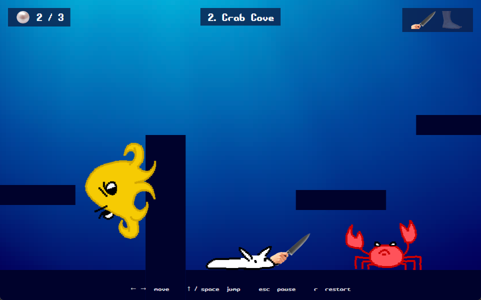

# Sluggity
A little sea slug with bigslug plans!

A small 2D platformer about Mike, a sea slug who finds a knife and a pair of legs on the ocean floor.
Made from scratch in C# and WPF, no game engine.

<div align="center">
  
</div>

## Gameplay

3 levels. Grab every pearl you can.

Found a **knife**? Slice anyone in front of you! Found **legs**? Jump twice! Got both? Meet combo Mike!

Be careful! There are dangers on the way. Crabs patrol the platforms, octopuses crawl up the walls, and spikes are waiting at the bottom. Jump on an enemy to beat it. Touch it any other way and it's back to the start!

### Controls

| Key           | Action |
|---------------|---|
| ← → / A D     | move |
| ↑ / W / Space | jump |
| Esc           | pause |
| R             | restart |

## How it works

- the game updates every frame on a WPF canvas, no game engine
- collisions use simple rectangles (AABB)
- levels are JSON files in `Scenes`
- the UI uses WPF data binding and styles
- progress is saved to `%AppData%\Sluggity\progress.json`

## How to make a level

You can build your own levels and send Mike on a brand new adventure!

Add a `.json` file to `Scenes`. Coordinates start in the bottom left corner, y goes up.

```json
{
  "SceneName": "My Level",
  "Size": [ 2000, 900 ],
  "GameObjectsData": [
    { "ObjectType": "Obstacle", "Position": [ 0, 0 ], "Size": [ 2000, 60 ] },
    { "ObjectType": "MovingObstacle", "Position": [ 600, 200 ], "Size": [ 200, 40 ], "Move": [ 300, 0 ] },
    { "ObjectType": "Spikes", "Position": [ 400, 60 ], "Size": [ 100, 0 ] },
    { "ObjectType": "Obstacle", "Position": [ 1200, 0 ], "Size": [ 60, 400 ] },
    { "ObjectType": "Octopus", "Position": [ 1100, 60 ] },
    { "ObjectType": "Crab", "Position": [ 800, 60 ] },
    { "ObjectType": "Pearl", "Position": [ 300, 120 ] },
    { "ObjectType": "Knife", "Position": [ 200, 90 ] },
    { "ObjectType": "Legs", "Position": [ 250, 90 ] },
    { "ObjectType": "SceneExit", "Position": [ 1800, 60 ] },
    { "ObjectType": "Player", "Position": [ 100, 60 ] }
  ]
}
```

An octopus has to be placed right next to a wall, it will crawl along it.
